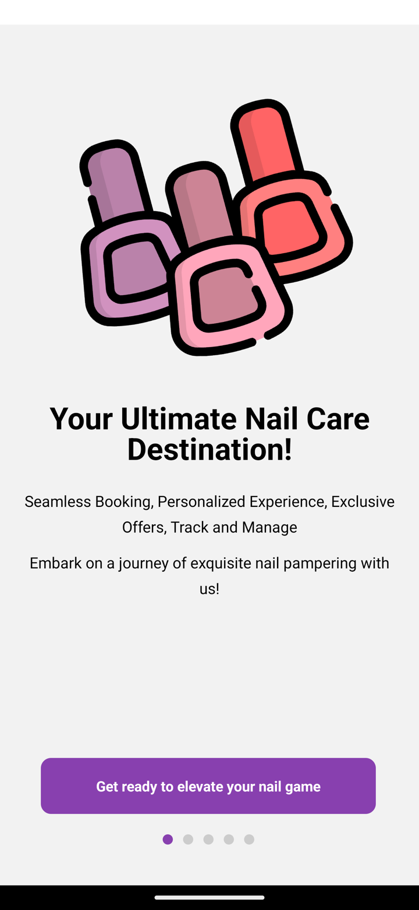
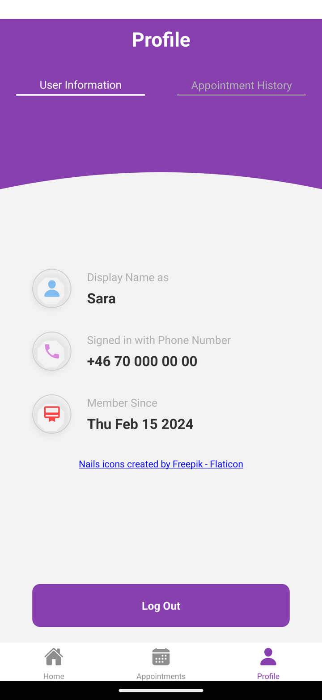
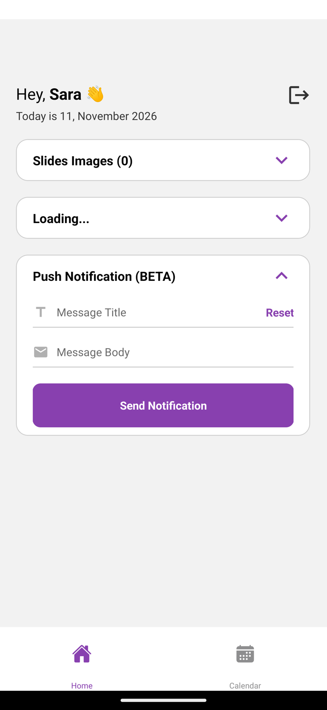
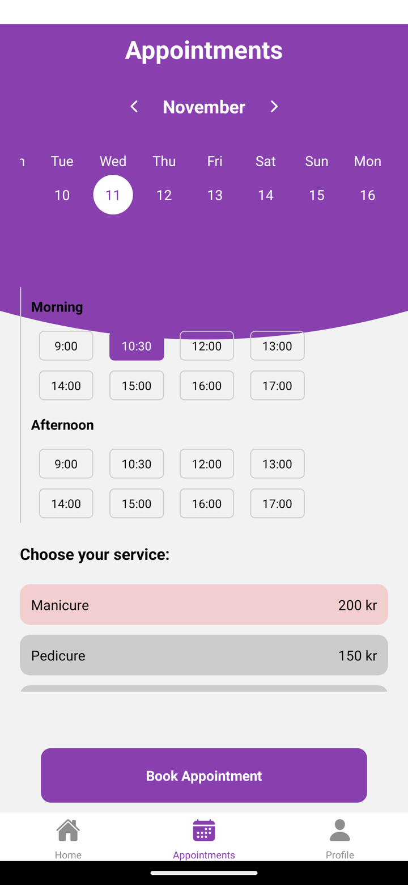
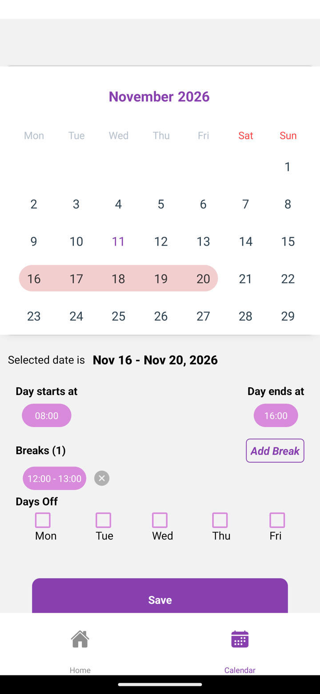

# Nail Salon App

**This is a prototype from 2024.** It was built between January and March 2024 and has not been developed since. It is not a finished product and was never released.

It is a mobile app for a single nail salon, built with React Native, Expo and Firebase. The idea: customers sign up with their phone number and book appointments, and the salon admin manages the home-screen images, the customer list and the salon's working hours from a separate interface.

Some of that works and some of it is screens only. Both lists are below.

The screenshots were taken on an Android emulator in November 2026. The SMS sign-in step was skipped for them, and the name and phone number shown are placeholders.

## What works

These parts run end to end against Firebase.

### Sign-in and navigation

- Phone-number sign-up and sign-in with an SMS code, as an animated five-step flow
- The session persists across app restarts
- The app shows the customer or the admin interface depending on the `isAdmin` field of the signed-in user's Firestore document
- Log out



### Customer

- Home screen with an image slider loaded from Firebase Storage
- Grid of service categories
- Profile screen with name, phone number and member-since date



### Admin

- Add and remove slider images from the device photo library
- List of all registered users, read from Firestore
- Send a push notification to the admin's own device



## What doesn't work

### Screens with no backend

- **Booking an appointment.** The date picker, time slots and service list can be used, but "Book Appointment" saves nothing. Time slots, services and prices are hardcoded.
- **Admin calendar.** Selecting a day or a range and setting working hours, breaks and days off all work on screen, but "Save" stores nothing, and the customer side does not read availability.
- **Appointment history** and the **service detail screen** are placeholders.

 

Left: the appointment screen. Right: the admin calendar with a range selected. Neither saves anything.

### Missing or incomplete

- Push notifications cannot reach customers. Push tokens are not stored per user, and nothing is sent for bookings or reminders.
- Firestore and Storage security rules are not part of this repository, and the admin check happens only in the app.
- Errors from Firebase are logged to the console and not shown to the user.
- `npm run ts:check` reports type errors.
- There are no automated tests and no linting setup.
- There is no release signing configuration.
- The Android build does not work from a fresh checkout. Getting it to run for the screenshots took four fixes that are not in this repository: an outdated Gradle script in the `expo-firebase-core` dependency, `react-native-svg` missing from `package.json`, string border widths in the sign-up animation that crash on Android, and the purple header on the appointment screen being clipped on Android.

## Tech stack

| Area | Choice |
|---|---|
| Framework | Expo SDK 50, React Native 0.73, React 18 |
| Language | TypeScript (strict mode enabled) |
| Navigation | React Navigation 6 (native stack and bottom tabs) |
| State | React Context and hooks |
| Backend | Firebase Auth (phone), Firestore, Storage |
| Push | `expo-notifications` with Expo's push service |
| Dates | `date-fns` |
| UI | `react-native-calendars`, `react-native-timer-picker`, `@expo/vector-icons`, `@rneui/themed` |

These versions are from early 2024 and have not been upgraded.

## Running it

You need Node.js 18 or newer, Xcode or Android Studio (the app uses a development build, not Expo Go), and a Firebase project with **Phone** sign-in, **Firestore** and **Storage** enabled.

1. Install dependencies:

   ```sh
   npm install
   ```

2. Create a `.env` file in the project root with your Firebase web app config:

   ```sh
   FIREBASE_API_KEY=
   FIREBASE_AUTH_DOMAIN=
   FIREBASE_PROJECT_ID=
   FIREBASE_STORAGE_BUCKET=
   FIREBASE_MESSAGING_SENDER_ID=
   FIREBASE_APP_ID=
   FIREBASE_MEASUREMENT_ID=
   ```

3. Replace `google-services.json` (project root and `android/app/`) with the one from your Firebase project, and update the storage bucket URL in `src/firebase/index.ts`.

4. Run the app:

   ```sh
   npm run ios
   # or
   npm run android
   ```

New users are created with `isAdmin: false`. To see the admin interface, set `isAdmin` to `true` on that user's document in the `users` collection in the Firebase console, then sign in again.

## Project structure

```
App.tsx                 Entry point: auth gate and navigation container
firebase.config.js      Firebase initialisation
src/
  screens/              auth, user and admin screens
  components/           auth, user, admin and shared components
  navigations/          Auth stack, role switch, user tabs, admin tabs
  contexts/             AuthContext (session) and UserContext (profile and role)
  hooks/                Calendar, push notification and UI hooks
  firebase/             Auth, Firestore and Storage helpers
  utils/                Colours, icons, strings and shared styles
```

## Credits

Nail icons created by Freepik - [Flaticon](https://www.flaticon.com/free-icons/nails).
